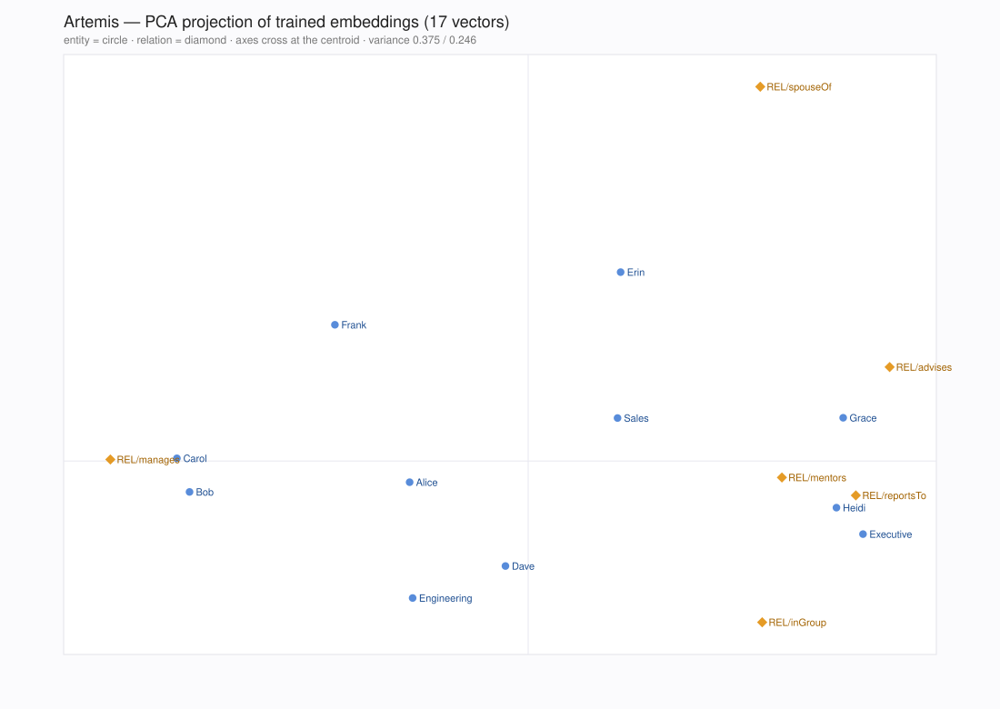

# Artemis

**TransE knowledge-graph embeddings in Nim.**

Artemis trains [TransE](https://papers.nips.cc/paper/5023-translating-embeddings-for-modeling-multi-relational-data)
embeddings (Bordes et al., NeurIPS 2013) on a table of `head relation tail`
triples — or straight from a [Mermaid](https://mermaid.js.org) diagram —
evaluates them with standard link-prediction metrics, answers link-prediction
queries, draws the embedding space, and exports the learned vectors. One small
native binary, no Python anywhere.

Every true fact `(h, r, t)` is trained to satisfy `h + r ≈ t`; facts are pushed
against corrupted negatives with a margin-ranking loss and SGD.

Companion documents: [`DevLog.md`](DevLog.md) (build chronicle) and
[`Decisions.md`](Decisions.md) (decision records). Requirements and the
original plan live in `PRD.md` and `CODING_PLAN.md`.

---

## Install

Requires Nim ≥ 2.0 and nimble.

```sh
git clone https://github.com/unplugandplay/art-mis
cd art-mis
nimble deps            # installs arraymancer
nimble build -d:release
```

## Quickstart

```sh
# train on the bundled 16-triple family graph
./artemis train --data data/toy_family.tsv --dim 10 --epochs 200 --lr 0.05

# evaluate (self-eval here; see FB15k-237 section for the real numbers)
./artemis eval --model artemis_checkpoint.bin --data data/toy_family.tsv

# semantic sanity check: alice's nearest neighbour is her spouse
./artemis nearest --model artemis_checkpoint.bin --entity alice

# export plain-text embeddings + metadata
./artemis export --model artemis_checkpoint.bin --out out/
```

## From a Mermaid diagram to embeddings

A diagram you already have is enough — flowcharts, state, class and ER diagrams
become triples, and subgraphs become `inGroup` facts instead of having to be
repeated as edges.

```sh
# 1. diagram -> head/relation/tail triples (stdout, or --out FILE)
./artemis mermaid examples/company.mmd --out out/company.tsv

# 2. train on it (22 triples, so this takes about a second)
./artemis train --data out/company.tsv --dim 24 --lr 0.05 --epochs 600 \
  --lr-schedule linear --lr-min 0.001 --out out

# 3. ask for a fact the diagram states
./artemis predict --model out/artemis_checkpoint.bin --head Dave --rel spouseOf --k 3

# 4. see the embedding space: out/map.svg + out/projection.tsv
./artemis project --model out/artemis_checkpoint.bin --out out
```

Real output from step 3 (`Erin` is Dave's spouse in the diagram):

```
top 3 tails for (Dave, spouseOf, ?)
Erin                                 12.82485
Frank                                14.16890
Sales                                14.80359
```

The interesting part is step 3 with a *hidden* fact: delete one edge, retrain,
and the model puts it back at rank 1.

```sh
grep -v $'Alice\tmanages\tCarol' out/company.tsv > out/company_holdout.tsv
./artemis train --data out/company_holdout.tsv --dim 12 --lr 0.05 --epochs 2000 \
  --lr-schedule linear --lr-min 0.0005 --out out/holdout
./artemis predict --model out/holdout/artemis_checkpoint.bin --head Alice \
  --rel manages --filter out/company_holdout.tsv --k 3
```

```
top 3 tails for (Alice, manages, ?)  [21 known triples filtered]
Carol                                11.27643   <- the hidden edge, back at rank 1
Frank                                11.46970
Erin                                 11.80741
```

`docs/company-map.svg` is what step 4 produces for the bundled example (the
same command regenerates it byte for byte):



Naming rule: `alice[Alice]` connects as `alice` but is stored as `Alice`, so ids
are wiring and labels are entities. Unlabelled edges use `--default-rel`
(default `relatedTo`). Unsupported diagram kinds and unparsable lines are
reported on stderr, never guessed at.

## Data format

Tab-separated (or `--delimiter comma|space|CH`), one triple per line, in any
entity/relation vocabulary:

```
alice	spouseOf	david
alice	parentOf	bob
```

Malformed lines are skipped and counted. Ids are assigned in first-appearance
order, so runs are reproducible. For proper evaluation, train on one file and
evaluate on held-out triples — with `--valid` and `--test` supplied to `train`,
filtered metrics use all splits as the known-truth set; standalone `eval` needs
`--truth train.tsv,valid.tsv` to do the same.

## Commands

### `artemis train --data train.tsv [options]`

| Option | Default | Meaning |
|--------|---------|---------|
| `--dim N` | 50 | embedding dimension |
| `--margin F` | 1.0 | margin-ranking margin |
| `--lr F` | 0.01 | SGD learning rate |
| `--lr-schedule S` | constant | `constant`, `exp` (needs `--lr-decay`) or `linear` |
| `--lr-decay F` | 1.0 | per-epoch factor for `exp`, e.g. 0.99 |
| `--lr-min F` | 0.0 | floor for `exp`, final lr for `linear` |
| `--epochs N` | 1000 | max epochs |
| `--batch N` | 100 | batch size (shuffled each epoch) |
| `--neg N` | 1 | negatives per positive |
| `--norm l1\|l2` | l1 | dissimilarity norm ‖h+r−t‖ₚ |
| `--bern` / `--no-bern` | on | Bernoulli negative sampling |
| `--seed N` | 42 | RNG seed (deterministic runs) |
| `--eval-every N` | 0 | validation MRR + early stopping every N epochs |
| `--ckpt-every N` | 0 | write `out/ckpt_eN.bin` every N epochs |
| `--min-count N` | 1 | drop entities/relations seen fewer than N times |
| `--threads N` | 1 | evaluation workers (0 = one per core; training stays serial) |
| `--valid` / `--test` | — | extra splits (truth set + metrics) |
| `--out DIR` | . | checkpoints, `embeddings.tsv`, `vocab.json` |
| `--quiet` | off | suppress progress lines |

### Other commands

```sh
artemis eval    --model checkpoint.bin --data test.tsv [--threads N] \
                [--truth train.tsv,valid.tsv]
artemis export  --model checkpoint.bin --out dir
artemis nearest --model checkpoint.bin --entity NAME [--k 10] [--metric cosine|l2]
artemis mermaid FILE.mmd [--out triples.tsv] [--default-rel R] [--group-rel R]
artemis predict --model checkpoint.bin --rel NAME (--head NAME | --tail NAME) [--k 10]
artemis project --model checkpoint.bin [--out DIR]
artemis --version
```

`eval` filters ranks against the file it is evaluating; pass `--truth` with the
other splits to get the standard train∪valid∪test protocol — on the FB15k-237
reference checkpoint that is the difference between filtered MRR 0.157
(test-only truth) and the 0.207 reported below.

### `artemis mermaid FILE.mmd [options]`

| Option | Default | Meaning |
|--------|---------|---------|
| `--out FILE` | stdout | where to write the triples |
| `--default-rel R` | relatedTo | relation for edges without a label |
| `--group-rel R` | inGroup | relation linking a node to its subgraph |

Reads the line-based subset of Mermaid that carries graph structure:
`flowchart`/`graph` (`-->`, `---`, `-.->`, `==>`, `-->|rel|`, `-- rel -->`,
chains `A --> B --> C`, `A --> B & C`, `subgraph title … end`),
`stateDiagram(-v2)`, `classDiagram` and `erDiagram` (`A ||--o{ B : places`).
Attribute/member blocks are skipped, repeated triples are deduplicated, and
anything else is reported on stderr — a diagram with one odd line still converts.

### `artemis predict --model checkpoint.bin --rel NAME (--head NAME | --tail NAME)`

| Option | Default | Meaning |
|--------|---------|---------|
| `--k N` | 10 | how many candidates to print |
| `--filter F[,F...]` | — | drop candidates already true in these files |
| `--allow-self` | off | also propose the entity you already named |

Ranks candidates by `d(h, r, ·)` (with `--head`) or `d(·, r, t)` (with `--tail`),
best first, using the norm stored in the checkpoint. Distances are the
dissimilarity scores, so lower is better.

### `artemis project --model checkpoint.bin [--out DIR]`

Writes `map.svg` (self-contained scatter: entities are circles, relations are
diamonds, labelled) and `projection.tsv` (`name`, `kind`, `x`, `y`). The
projection is a PCA of the entity rows by power iteration with deflation — no
maths dependency — and is deterministic, so the same checkpoint always draws the
same picture. `--no-relations` and `--no-labels` trim the output.

## Library usage

```nim
import artemis

let hp = HyperParams(dim: 32, epochs: 200, lr: 0.01'f32,
                     lrSchedule: lsLinear, lrMin: 0.0005'f32)
let (data, entities, relations, report) = loadDataset("train.tsv", hp)
var rng = initRand(42)
var model = initModel(entities, relations, hp, rng)

let truth = buildTruthSet(data.train, data.valid, data.test)
let sampler = initSampler(data.train, relations.len, entities.len, true, truth)
discard train(model, data.train, sampler, hp, data.valid, truth)

# ranked on `threads` workers; lsLinear decays lr to hp.lrMin over hp.epochs
let metrics = evaluate(model, data.test, truth, hp.norm, threads = 0)
saveCheckpoint(model, hp, "ckpt.bin")
```

## Evaluation protocol

For each held-out triple, the true head is ranked against all entities (tail
fixed), then the true tail against all entities (head fixed): two ranks per
triple. Reported: Mean Rank, MRR, Hits@1/3/10 — *raw* and *filtered* (candidates
that form any known-true triple are excluded). Rank `= 1 + #better + 0.5·#ties`
(average tie handling; ties are rare with float32 scores).

Implementation: the known-true tails of each `(h, r)` and heads of each `(r, t)`
are indexed once and flattened into per-triple candidate lists, so the filtered
rank is `rawRank − #truth candidates that score better` and the rank loop stays
pure arithmetic (no hash probe per candidate). The pooled triples are then
evaluated in contiguous chunks on `--threads N` workers (default 1; `0` = one per
core). Training itself is always single-threaded, so a seed still reproduces
byte-identical embeddings; a fixed thread count reproduces the metrics (thread
count changes only the order of float64 additions — see `Decisions.md`, D16/D17).

## Results

### Bundled toy graph (16 triples, 8 entities, 3 relations — self-eval)

`--dim 10 --epochs 200 --lr 0.05`

| | MR | MRR | Hits@1 | Hits@3 | Hits@10 |
|---|---|---|---|---|---|
| raw | 1.66 | 0.682 | 0.375 | 1.000 | 1.000 |
| filtered | 1.47 | 0.766 | 0.531 | 1.000 | 1.000 |

Optimistic (evaluated on training triples), but a useful smoke signal: during
training the 8-entity ranking improves from MRR ≈ 0.29 to ≈ 0.68, and the nearest
neighbour of `alice` becomes her spouse `david` (cosine 0.943). Adding
`--lr-schedule linear` to the same command lifts it to raw MRR 0.781 / filtered
0.875 — the schedule helps at every scale.

### FB15k-237 (14,505 entities · 237 relations · 272,115 train triples)

```sh
scripts/get_data.sh

# reference configuration (3m41s wall with --threads 0 on 8 cores)
./artemis train --data data/fb15k237/train.txt --valid data/fb15k237/valid.txt \
  --test data/fb15k237/test.txt --dim 100 --lr 0.01 --epochs 1000 \
  --lr-schedule linear --lr-min 0.0005 --eval-every 100 --threads 0
```

| test (n = 40,876 ranks) | MR | MRR | Hits@1 | Hits@3 | Hits@10 |
|---|---|---|---|---|---|
| raw | 522.2 | 0.182 | 0.115 | 0.191 | 0.321 |
| filtered | 386.6 | **0.289** | 0.206 | 0.318 | **0.453** |

That matches published, tuned TransE baselines on FB15k-237 (filtered MRR ≈ 0.29
/ Hits@10 ≈ 0.46), and validation MRR rose monotonically across all ten evals
(0.196 → 0.289) — the budget, not the model, is still the limit.

### Getting there: budget and learning-rate schedule

The v0.1.0 reference was 200 epochs at a constant lr 0.01 (filtered MRR 0.207 /
Hits@10 0.343, ~15 min single-threaded). Everything below is the same data,
dim 100, margin 1.0, Bernoulli sampling and seed; only budget and schedule move:

| run | filtered MRR | Hits@10 | wall (`--threads 0`) |
|---|---|---|---|
| 200 epochs, constant lr | 0.207 | 0.343 | 2m01s |
| 500 epochs, constant lr | 0.218 | 0.364 | 2m38s |
| 500 epochs, exponential 0.99 → 1e-4 | 0.245 | 0.389 | 2m41s |
| 500 epochs, linear → 5e-4 | 0.264 | 0.421 | 2m40s |
| 1000 epochs, linear → 1e-4 | 0.288 | 0.451 | 3m44s |
| 1000 epochs, linear → 5e-4 | **0.289** | **0.453** | 3m41s |

(The two 1000-epoch floors differ by less than run-to-run spread — validation
MRR even favours 1e-4 — so read both rows as ≈0.29 / ≈0.45.)

Two lessons, measured rather than assumed. More epochs at a *constant* lr buy
almost nothing (+0.011 MRR for 2.5× the budget: the run oscillates in ±0.005
validation noise after ~epoch 300), while decaying the lr to a small floor lets
the same budget settle (+0.046 MRR over constant at 500 epochs, +0.071 at
1000). Linear decay beats exponential here (0.264 vs 0.245 at 500 epochs): it
stays in the productive lr range longer and only anneals at the end.

`--threads 0` is what makes the table cheap: ranking is ~95 % of a run's wall
clock, so the 1000-epoch reference costs 3m41s instead of ~15 min single-threaded
(2.5 min of training, ~11 min of validation passes, ~1 min of test ranking), with
numbers identical to the single-threaded path. Evaluating a saved checkpoint
standalone needs `--truth train.tsv,valid.tsv` for the same filtered basis (see
*Other commands*).

### Performance (release build, Apple Silicon)

Synthetic scale — 15,000 entities × 200 relations × 500,000 random triples,
dim 50 (`nimble bench`), single thread:

| Metric | Value |
|---|---|
| training throughput | ~850,000 triples/s |
| epoch time (500k triples) | 0.59 s |
| peak RSS | 273 MB |

The per-triple hot loop performs no allocations (preallocated scratch buffers,
raw row-major access), so epoch time scales linearly with triples × dim.

Link-prediction evaluation — FB15k-237 valid (17,526 triples ranked against
14,505 entities, dim 100, L1), one full raw + filtered pass:

| Workers | Wall | Notes |
|---|---|---|
| 1 | 42.3 s | pre-index implementation was 65 s on the same machine |
| 2 | 21.6 s | |
| 4 | 13.2 s | measured with one core busy training, so 8 is conservative |
| 8 | 10.1 s | metrics identical at every thread count |

## Design notes

Deliberate deviations from the original blueprint — rationale in `Decisions.md`:

1. **Manual closed-form gradients, not Arraymancer autograd.** For `x = h+r−t`,
   `‖x‖₂` has gradient `x/‖x‖₂` and `‖x‖₁` has gradient `sign(x)`. The
   blueprint's `discard` placeholder is replaced by this math applied to the
   3–4 affected embedding rows directly. Validated by a finite-difference test
   (`tests/t_gradients.nim`) to 1e-2 on float32.
2. **Unit-norm constraint on entities after every update** (paper requirement,
   absent from the blueprint): entity rows are re-projected onto the unit L2
   sphere; relation rows are unconstrained. An invariant test enforces it.
3. **Fused loops instead of Arraymancer broadcasting** for per-triple scoring:
   identical complexity, zero temporaries, no allocation in the hot path.
4. **Sequential SGD updates on shared rows** (`h` in both pos/neg, `r` in both)
   handle head- vs tail-corruption uniformly by applying the two update terms
   in sequence; the test suite checks both sides numerically.
5. `export.nim` → `persist.nim`: `export` is a Nim keyword and cannot appear in
   an `export` list.
6. **Evaluation is indexed and chunk-parallel** (`--threads`), while SGD stays
   serial: filtered ranks come from a pre-built `(h, r)` / `(r, t)` candidate
   index instead of a hash probe per candidate, and workers share a GC-free raw
   view of the embeddings. Parallelism is spent where it cannot break the
   determinism guarantee.
7. **Learning-rate schedule is a pure function of the epoch** (`scheduledLr`),
   constant by default so v0.1.0 runs stay bit-identical, with linear and
   exponential decay opt-in. On FB15k-237 this single knob is worth more than
   any reasonable epoch increase at a constant lr (see *Results*).
8. **External formats are parsed, never guessed.** The Mermaid importer is a
   line-based scanner over a documented subset: node ids are wiring, shapes are
   entity names, subgraphs become `inGroup` triples, unsupported diagrams and
   unparsable lines are reported on stderr. `project` likewise implements PCA
   (power iteration + deflation) and SVG output in ~150 dependency-free lines
   rather than pulling in a maths or plotting library.

## Tests

```sh
nimble test        # 68 unit tests
nimble bench       # synthetic-scale throughput benchmark
```

Coverage: TSV parsing, vocab order/min-count, init determinism, unit-norm
invariants, hand-computed L1/L2 distances, negative-sampling distributions,
finite-difference gradient check, convergence + determinism on the toy graph,
a hand-computed evaluation fixture (raw & filtered), bit-exact checkpoint
round-trips, learning-rate schedule math (endpoints, decay, floor) plus a
decayed run that still converges, Mermaid parsing (flowchart/state/class/ER,
labels, subgraphs, dedup, malformed lines), hand-computed link-prediction
rankings, PCA fixtures with TSV/SVG output checks, and — for the evaluation
rewrite — a per-candidate oracle that the indexed/threaded ranks must match on
both norms at 1, 3, 4, 8 and 16 workers.

## Non-goals

Other KGE models (RotatE, ComplEx, …), GPU, distributed training, hyperparameter
search, servers. Architecturally, `transEGrad`/`computePair` is the only place
that would need extending for a new norm-based model.

## Release notes

### v0.3.0

- **`artemis mermaid diagram.mmd`** — Mermaid flowcharts, state, class and ER
  diagrams become triples; node shapes provide entity names and subgraphs become
  `inGroup` facts. Bundled example: `examples/company.mmd` → 11 entities,
  14 edges, 8 group links.
- **`artemis predict`** — link-prediction queries on a trained model:
  `--head NAME --rel NAME` ranks tails, `--tail NAME --rel NAME` ranks heads,
  `--filter train.tsv` hides facts that are already known, and a hidden edge
  comes back at rank 1 in the bundled example.
- **`artemis project`** — PCA (power iteration, no maths dependency) of the
  embeddings into a labelled `map.svg` plus `projection.tsv`; deterministic, so
  the same checkpoint always draws the same picture.
- `artemis --version` unchanged in spirit: the binary reports 0.3.0.
- 68 unit tests (39 at v0.2.0).

### v0.2.0

- **Parallel evaluation** — `--threads N` (`0` = one per core): filtered ranks
  come from a pre-built `(h, r)` / `(r, t)` candidate index and pooled triples
  are ranked on worker threads. One FB15k-237 validation pass: 65 s → 42 s → 10 s
  on 8 cores, metrics unchanged. Training stays serial, so seeded runs remain
  bit-reproducible.
- **Learning-rate schedules** — `--lr-schedule constant|exp|linear` with
  `--lr-decay` / `--lr-min`. On FB15k-237, 1000 epochs with linear decay reach
  filtered MRR **0.289** / Hits@10 **0.453** (v0.1.0: 0.207 / 0.343) in 3m41s.
- **`eval --truth train.tsv,valid.tsv`** — standalone evaluation can filter
  against the full train ∪ valid ∪ test truth set (FR-6) instead of the
  evaluated file alone.
- **Build fix** — the implementation under `src/artemis/` is tracked again; a
  `.gitignore` pattern had been hiding the whole source directory, so a fresh
  clone of v0.1.0 could not build.
- 39 unit tests (30 at v0.1.0), release build warning-free.

### v0.1.0

Initial release: TransE training (L1/L2, uniform/Bernoulli negative sampling,
unit-norm constraint), raw + filtered link-prediction metrics, checkpoints and
TSV/JSON export, the `train`/`eval`/`export`/`nearest` CLI, a bundled toy graph
and the FB15k-237 reference run.

## License

MIT